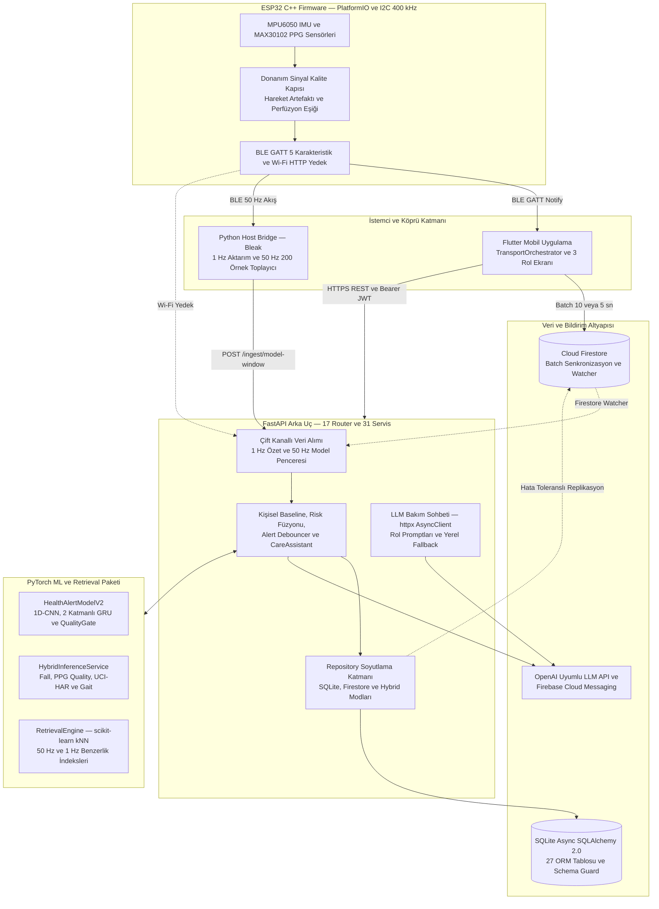
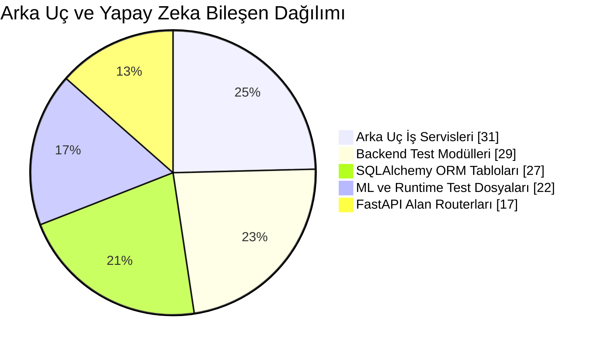
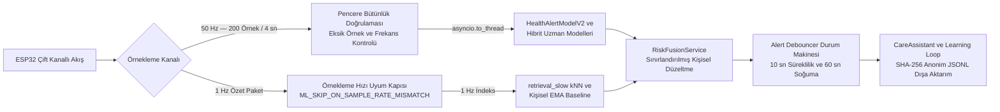
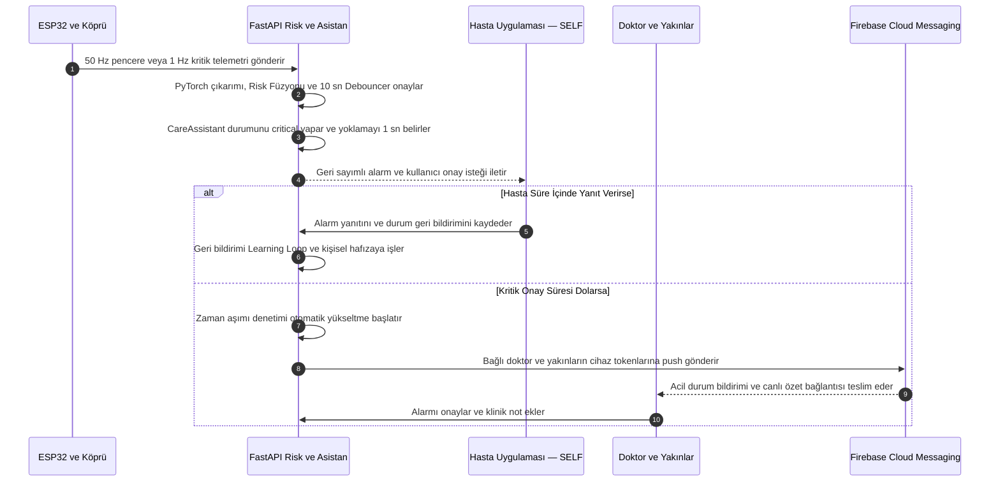
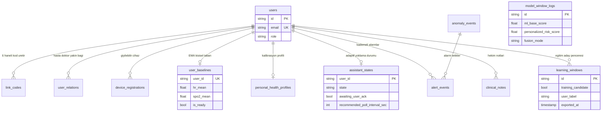

# HealthAlert — Çok Modalli Yapay Zeka ve IoT Destekli Uzaktan Sağlık İzleme Sistemi

> **Erişim ve Şeffaflık Notu:** HealthAlert, donanım prototipi ve çok modalli yapay zeka modelleriyle birlikte özel bir depoda geliştirilen uçtan uca bir mühendislik projesidir. Bu doküman; sistemin gömülü yazılım, mobil istemci, asenkron arka uç, hibrit veritabanı ve PyTorch çıkarım mimarisini incelemek isteyen geliştiriciler ve teknik yöneticiler için hazırlanmıştır.

## Proje Özeti ve Çözdüğü Problem

Giyilebilir sensörlerle yürütülen uzaktan sağlık takibinde en büyük mühendislik engeli, ham sensör akışındaki hareket kaynaklı gürültü ile bireyler arasındaki fizyolojik farklılıkların sürekli yanlış alarmlara yol açmasıdır. Sabit eşiklere dayanan geleneksel izleme sistemleri kullanıcıların dinlenme nabzını, günlük aktivite düzenini veya sensör temas kalitesini hesaba katmadığı için ya gereksiz uyarı üretir ya da gerçek acil durumları geç fark eder.

HealthAlert, ESP32 tabanlı giyilebilir sensörlerden toplanan ivmeölçer, jiroskop, nabız ve oksijen doygunluğu verilerini BLE ve Wi-Fi kanalları üzerinden işleyerek düşme ve fizyolojik anomali risklerini tespit eden beş katmanlı bir izleme platformudur. Sistem; `SELF` rolündeki hasta, `RELATIVE` rolündeki hasta yakını ve `DOCTOR` rolündeki hekim için ayrıştırılmış erişim akışlarıyla canlı durum takibi, kademeli alarm yönetimi, klinik not paylaşımı ve bağlam farkında bakım sohbeti sunar. Yanlış alarm sorununu çözmek için donanım seviyesinde sinyal kalite kapıları, PyTorch tabanlı çok modalli derin öğrenme modelleri, üstel hareketli ortalama ile öğrenilen kişisel taban çizgisi ve sürdürülebilir risk doğrulama mekanizmaları birlikte çalışır.

## Sistem Mimarisi ve Beş Katmanlı Monorepo Kurgusu

Proje; ESP32 C++ gömülü yazılımı, Python tabanlı masaüstü BLE köprüsü, Flutter çapraz platform mobil uygulaması, FastAPI asenkron arka uç servisi ve bağımsız PyTorch yapay zeka paketinden oluşan çok katmanlı bir monorepo düzenindedir. Kod tabanında WebSocket veya ses sentezi bağlantısı kullanılmaz. Gerçek zamanlı veri iletimi cihaz ile mobil arasında BLE GATT bildirimleri, mobil ile bulut arasında Cloud Firestore eşitlemesi, istemci ile sunucu arasında ise risk seviyesine göre sıklığı dinamik değişen adaptif HTTP yoklaması üzerinden yürütülür.



Arka uç katmanı, dış bağımlılıklar eksik veya erişilemez olduğunda sistemin çökmesini engelleyen açık geri dönüş prensibiyle kurgulanmıştır. `DATA_MODE` yapılandırmasıyla yerel SQLite, Cloud Firestore veya hibrit depolama arasında geçiş yapılabilir. Hibrit modda çalışan `_HybridRepo` sınıfı, okuma isteklerini düşük gecikmeyle yerel SQLite veritabanından karşılarken yazma işlemlerini önce yerel diske kaydeder, ardından hata toleranslı biçimde Firestore koleksiyonlarına yansıtır. Benzer şekilde Firebase kimlik bilgileri bulunmadığında sistem yerel depolamaya, FCM anahtarı olmadığında yoklama moduna, dil modeli erişilemediğinde kural tabanlı yerel yanıtlayıcıya ve PyTorch modeli hazır değilse kişiselleştirilmiş sezgisel risk skorlamasına kesintisiz geçiş yapar.



Mobil istemci tarafında harici durum yönetimi paketlerine bağımlılık eklenmeden Flutter yerleşik `ChangeNotifier` ve `InheritedNotifier` mekanizmalarıyla yalın bir `AppController` yapısı kurulmuştur. Hem ESP32 yazılımı hem Flutter uygulaması `TransportOrchestrator` bileşeniyle BLE birincil kanalını ve Wi-Fi yedek kanalını otomatik yönetir. Mobil uygulama `flutter_reactive_ble` üzerinden aldığı telemetri paketlerini kuyruklayarak her on pakette veya beş saniyede bir toplu olarak Firestore üzerine aktarır.

## Çift Kanallı Telemetri, PyTorch Füzyon ve Yanlış Alarm Koruması

Sağlık izleme yapay zeka modellerinde en sık yapılan mimari hatalardan biri, yüksek frekansta eğitilmiş zaman serisi modellerini düşük frekanslı özet verilere doğrudan uygulamaktır. HealthAlert bu veri kayması riskini ortadan kaldırmak için telemetri hattını iki ayrı frekans kanalına ayırır. Özet telemetri akışı saniyede bir kez `POST /ingest/device-packet` ucuna ulaşırken, ham ivmeölçer ve PPG verileri masaüstü köprüsündeki toplayıcı tarafından saniyede 50 örnekten oluşan dört saniyelik 200 örneklik pencereler halinde birleştirilip eksik örnek ve etkin frekans doğrulamasından sonra `POST /ingest/model-window` ucuna gönderilir.



Yapay zeka çekirdeği `healthalert_final_ai` paketi içinde 20'den fazla biyomedikal veri setini destekleyen eğitim ve çıkarım altyapısına sahiptir. Çok modalli `HealthAlertModelV2` mimarisi; IMU sinyalleri için tek boyutlu evrişim ve iki katmanlı GRU, PPG sinyalleri için tek boyutlu evrişim, yaşamsal bulgular için çok katmanlı algılayıcı ve 38 boyutlu el yapımı öznitelik ağı kollarını `QualityGate` ile ağırlıklandırıp dört başlıklı `FusionAttention` katmanında birleştirir. Çıkarım sonucunda düşme, kararsızlık, sinyal kalitesi ve genel risk tahminleri üretilir.

Çalışma zamanı yönetişimi ve kapalı döngü öğrenme tasarımı şu katmanlarla güvence altına alınmıştır:

* **Olay Döngüsünü Bloklamayan Çıkarım ve Model Yönetişimi:** 50 Hz pencere akışı geldiğinde PyTorch çıkarımı `asyncio.to_thread` ile ayrı iş parçacığında çalıştırılarak FastAPI olay döngüsünün tıkanması önlenir. `HybridInferenceService`, YAML yönlendirme politikasıyla düşme, PPG kalitesi, aktivite ve yürüyüş kararsızlığı uzman modellerini koordine ederken reddedilmiş deneysel kontrol noktalarının yüklenmesini `REJECTED_MODEL_PATH_MARKERS` denetimiyle programatik olarak engeller.

* **Sinyal Kalitesi Kapılı Kişisel Baseline ve Risk Debouncer:** Kişisel fizyolojik taban çizgisi üstel hareketli ortalama yöntemiyle yalnızca yüksek sinyal kaliteli ve normal riskli paketlerden güncellenir. Risk füzyonundan çıkan puanlar tek bir anlık sıçramayla alarm üretmez; `alert_debouncer` durum makinesi riskli durumun en az 10 saniye boyunca kesintisiz sürmesini şart koşar ve yeni uyarılar arasında 60 saniyelik soğuma süresi uygular.

* **Anonimleştirilmiş Kapalı Döngü Veri Toplama:** `LearningDataService`, uyarı ve kritik pencereleri ile kullanıcıların `ok`, `false_alarm`, `fall_confirmed` veya `sensor_error` geri bildirimlerini yeniden eğitim hattı için JSONL formatında dışa aktarır. Dışa aktarım sırasında kullanıcı ve cihaz kimlikleri SHA-256 özetinin ilk 16 karakteriyle anonimleştirilir ve demo verilerinin eğitim setini kirletmesi politika bayraklarıyla engellenir.

## Kademeli Bakım Asistanı, Adaptif Yoklama ve Acil Durum Akışı

Sistem yüksek riskli bir anomali veya düşme algıladığında `CareAssistant` durum makinesi devreye girer. Durum makinesi `normal`, `watch`, `warning` ve `critical` seviyeleri arasında geçiş yaparak istemcinin sunucuyu yoklama aralığını normal durumda 60 saniyeden, izleme durumunda 10 saniyeye, kritik durumda ise 1 saniyeye kadar dinamik olarak sıklaştırır. Böylece pil ve ağ tüketimi olağan zamanlarda minimumda tutulurken acil durumlarda saniye düzeyinde tepki hızı elde edilir.



Buna ek olarak kullanıcılar, canlı vital verilerini, aktif alarmlarını, kişisel trendlerini ve doktorun bıraktığı klinik notları otomatik olarak bağlama dahil eden sohbet asistanıyla konuşabilir. `chat_service.py` ve `llm_client.py` bileşenleri OpenAI uyumlu `/chat/completions` arayüzüne `httpx.AsyncClient` üzerinden üç tekrar denemeli asenkron çağrı yapar; oturum geçmişini en fazla 500 oturum ve oturum başına 20 mesajla sınırlandırır ve uzak servis erişilemediğinde yerel kural tabanlı yanıt üreticisiyle hizmet kesintisini önler.

## Veritabanı Mimarisi ve Hibrit Veri Modelleme

İlişkisel veri katmanı asenkron SQLAlchemy 2.0 ve `aiosqlite` sürücüsü üzerinde UUID metin birincil anahtarlı 27 ORM tablosundan oluşur. Uygulama başlangıcında `init_db` mekanizması tabloları oluşturur ve `PRAGMA table_info` tabanlı şema koruma geçişleriyle eksik kolonları geriye dönük uyumlu biçimde tamamlar. Bulut tarafında ise 15 temel koleksiyon Cloud Firestore üzerinde senkronize tutulur.



| Veri Alanı | Tablo Sayısı | Kapsanan Tablolar | Temel Veri Tasarımı |
| :--- | :---: | :--- | :--- |
| Kimlik ve İlişkiler | 3 | `users`, `link_codes`, `user_relations` | Benzersiz e-posta, 48 saat ömürlü tek kullanımlık 6 haneli kodlar ve aktif ilişki denetimi |
| Telemetri ve Cihazlar | 4 | `device_registrations`, `device_packet_logs`, `live_statuses`, `model_window_logs` | Ham IMU ve PPG kayıtları, sinyal kalite bayrakları, canlı durum ve ML füzyon puanları |
| Olay, Alarm ve Klinik | 6 | `anomaly_events`, `alert_events`, `post_event_sessions`, `history_items`, `notification_items`, `clinical_notes` | Geri sayımlı alarmlar, JSON öneriler, olay sonrası oturumlar ve hekim notları |
| Kişiselleştirme ve Baseline | 4 | `user_baselines`, `personal_health_profiles`, `personal_risk_memories`, `personal_trend_snapshots` | EMA istatistikleri, soğuk başlangıçtan olgunluğa profil evreleri ve gündüz-gece düzeni |
| Öğrenme Döngüsü ve MLOps | 4 | `learning_capture_sessions`, `learning_windows`, `user_feedback_events`, `model_version_registry` | Gölge çıkarım özetleri, kullanıcı etiketleri, dışa aktarım takibi ve model sürüm kaydı |
| Bakım Asistanı ve Sistem | 6 | `assistant_states`, `assistant_actions`, `assistant_acknowledgements`, `app_settings`, `simulation_states`, `device_tokens` | Adaptif yoklama sıklığı, onay zaman aşımı, hassasiyet ayarları ve otomatik temizlenen FCM tokenları |

## Güvenlik, Rol Bazlı Erişim ve İlişki Denetimi

Sağlık verilerinin hassasiyeti nedeniyle yetkilendirme modeli yalnızca kullanıcı rolüne değil, hasta ile diğer roller arasındaki onaylı ilişki ağına bağlanmıştır.

* **Kimlik Doğrulama ve Parola Güvenliği:** Parolalar `passlib` ve `bcrypt` ile hashlenerek saklanır. Oturumlar `python-jose` kütüphanesiyle HS256 imzalı Bearer JWT belirteçleri üzerinden yürütülür ve her korumalı istekte kullanıcı kaydı veritabanından yeniden doğrulanır.

* **İlişki Temelli Hasta Veri İzolasyonu:** Yalnızca `SELF` rolündeki hasta, 48 saat geçerli ve tek kullanımlık 6 haneli bir bağlantı kodu üretebilir. Kod üretilirken alıcı rolün `RELATIVE` veya `DOCTOR` olacağı belirlenir ve farklı roldeki bir kullanıcının bu kodu kullanması engellenir. Hasta verisi, canlı izleme, alarm, geçmiş, bakım asistanı ve sohbet uç noktalarının tamamında `find_active_link` kontrolü yapılır; aktif bağlantı bulunmayan her erişim 403 hatasıyla reddedilir.

* **Eylem ve Rol Ayrımı:** Yardım çağrısı başlatma ve aktif alarma yanıt verme yetkisi yalnızca hastaya tanınır; alarm onaylama işlemi bağlı doktor ve yakınlarla sınırlandırılır. Klinik not oluşturma, güncelleme ve silme yetkisi ise yalnızca aktif ilişkisi olan hekime ve kendi oluşturduğu notlara kısıtlanır.

* **Katı Şema ve Pencere Doğrulaması:** Pydantic v2 doğrulayıcıları ham 50 Hz model pencerelerinde örnek sayısının IMU ve PPG dizileriyle birebir eşleşmesini, her IMU satırının altı eksenli olmasını, zaman damgalarının tutarlılığını ve sohbet girdilerinin karakter sınırlarını sunucu kapısında denetler.

## Teknik Kod Tabanı Raporu ve Doğrulanmış Teknoloji Yığını

Aşağıdaki metrikler ve teknoloji envanteri, depodaki `requirements.txt`, `pyproject.toml`, `pubspec.yaml`, `platformio.ini` ve kaynak kod dosyaları doğrudan incelenerek yalnızca aktif kullanılan bileşenleri içerecek şekilde çıkarılmıştır.

| Teknik Ölçüt | Doğrulanmış Değer | Kapsam Açıklaması |
| :--- | :--- | :--- |
| Monorepo Mimarisi | 5 Ana Bileşen | ESP32 Firmware, Python Host Bridge, Flutter Mobil, FastAPI Backend ve PyTorch ML Paketi |
| Arka Uç Yapısı | 17 Router ve 31 Servis | 4 kök tanılama ucu, hibrit repository katmanı ve asenkron LLM/FCM entegrasyonu |
| Veritabanı Şeması | 27 ORM Tablosu | Async SQLAlchemy 2.0, SQLite schema guard geçişleri ve 15 Cloud Firestore koleksiyonu |
| Yapay Zeka Altyapısı | Çok Modalli PyTorch ve kNN | `HealthAlertModelV2`, 4 uzman model runtime ve 50 Hz ile 1 Hz retrieval indeksleri |
| Otomatik Test Altyapısı | 51+ Test Modülü | Backend içinde 29, ML ve runtime paketinde 22 pytest dosyası ile köprü testleri |

| Mimari Katman | Aktif Kullanılan Teknolojiler |
| :--- | :--- |
| Gömülü Yazılım | PlatformIO, ESP32, C++ Arduino Framework, MPU6050, SparkFun MAX3010x, ArduinoJson, BLE GATT ve Wi-Fi |
| Masaüstü Köprü | Python, Bleak, Requests, Pydantic ve Click |
| Arka Uç ve Veri | Python, FastAPI, Uvicorn, Pydantic v2, Async SQLAlchemy 2.0, Aiosqlite, Cloud Firestore ve Firebase Admin |
| Güvenlik ve İletişim | Passlib, Bcrypt, Python-Jose HS256 JWT, Httpx AsyncClient, OpenAI Uyumlu LLM API ve FCM |
| Yapay Zeka ve Sinyal İşleme | PyTorch, NumPy, Pandas, SciPy, Scikit-Learn, Joblib, OmegaConf, WFDB ve H5PY |
| Mobil İstemci | Flutter, Dart, Flutter Reactive BLE, Cloud Firestore, Flutter Local Notifications, FL Chart ve Connectivity Plus |
| Test ve Kod Kalitesi | Pytest, Pytest-Asyncio, Black ve Ruff |

## Çalıştırma ve Yapılandırma Referansı

Proje konteyner manifestleri olmadan yerel ve sunucu tabanlı çalışma profilleriyle kurgulanmıştır. Arka uç servisi `APP_MODE`, `DATA_MODE`, `AI_MODE` ve `NOTIFICATION_MODE` ortam değişkenleriyle demo, yerel veya üretim profillerine geçiş yapar; mobil uygulama ise derleme zamanında `--dart-define` bayraklarıyla sunucu adresi ve taşıma modunu alır.

```bash
# FastAPI arka uç sunucusunu yerel ortamda başlatma
uvicorn backend.main:app --host 0.0.0.0 --port 8000 --reload

# Arka uç ve PyTorch yapay zeka test paketlerini çalıştırma
pytest backend/tests/module7
pytest healthalert_final_ai/tests

# BLE 50 Hz model penceresi toplayıcısını başlatma
python host_bridge/ble_model_window_collector.py
```

**Geliştiren:** Yusuf Karagöz — Yazılım Mühendisi